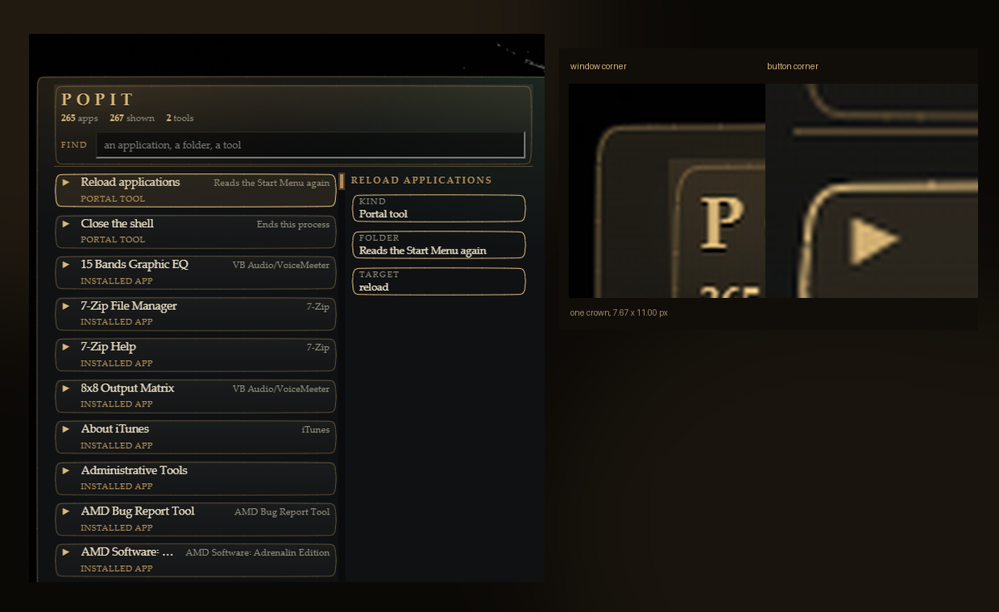

# Popit shell

A Windows desktop shell whose taskbar and windows are framed by one measured contour.
Python 3.13, PySide6 QtWebEngine for the host, and an HTML/CSS/JS view served over
loopback on `127.0.0.1:5199`.

This repository is also the pinned **family look**: the visual example every family
application is measured against. The look is written down in
[`docs/family-look.md`](docs/family-look.md) and pinned in
[`tools/family_look.json`](tools/family_look.json).



## Run

```
pip install -r requirements.txt
python shell.py                  # the bar that owns the strip, plus its launcher
python server.py                 # only the view, on http://127.0.0.1:5199/
python window.py                 # only the launcher window, masked to the contour
```

`POPIT_PORT` moves the port; `window.py <port>` follows it.

Starting `shell.py` hides Explorer's own bar, reserves the bottom 48 px as an AppBar, and
keeps both true while it runs. `Start`, then `Close the shell`, releases the strip and
shows Explorer's bar again. Drag the launcher by its header to move it.

## What is here

| Path | What it is |
|---|---|
| `contour.json` | The measured contour: one start point and eight cubics, in the PDF's own units |
| `server.py` | Loopback server: `/api/state`, `/api/open`, `/api/move`, the UI files |
| `window.py` | Frameless Qt host, masked to the contour at its own size |
| `shell.py` | The process that owns the strip: bar window, launcher window, in-process server |
| `desktop.py` | The Windows calls: the AppBar reservation, hiding Explorer's bar, the window list |
| `ui/` | The launcher view: plate, Find row, application column, facts column, brass scrollbars |
| `ui/bar.*` | The bar: start cell, running-window cells, clock |
| `ui/contour.js` | The only shape authority: `contourPath` and `contourWindowPath` |
| `tools/gate.py` | 20 checks and a selftest: the contour, the pins and the refusals |

## The shape rule

The contour is the framing authority. It is a nine-slice of one profile: four corners
scaled by a single factor and rails that lengthen, so nothing is stretched on one axis and
no crown leaves its box. One corner, 7.67 by 11.00 px, is used by a bar cell, a card, a
field, the plate and a window frame alike.

The body paints through a path clip at 0.5 px and the frame is the same contour stroked at
1 px from 1.5 px, so the stroke is always whole. A window's mask sits at the window box and
never cuts the outline.

## Check

```
python tools/gate.py            # refusals are named, not argued with
python tools/gate.py --selftest # the gate rejects a planted break
```

The gate refuses a contour that stretches, a crown outside its frame, a window frame that
scales its corner to the window, a mask that cuts the stroke, and any change to the pinned
taskbar `tools/bar_pin.json`. `tools/family_look.json` is the family pin, and the gate
refuses a pin that no longer matches what the surfaces draw.

## Releases

CI runs the gate on every push and packages `dist/popit-shell.zip`. A `v*` tag runs the
same gate and attaches that archive to the release.
